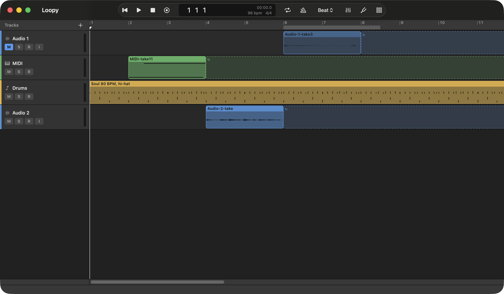
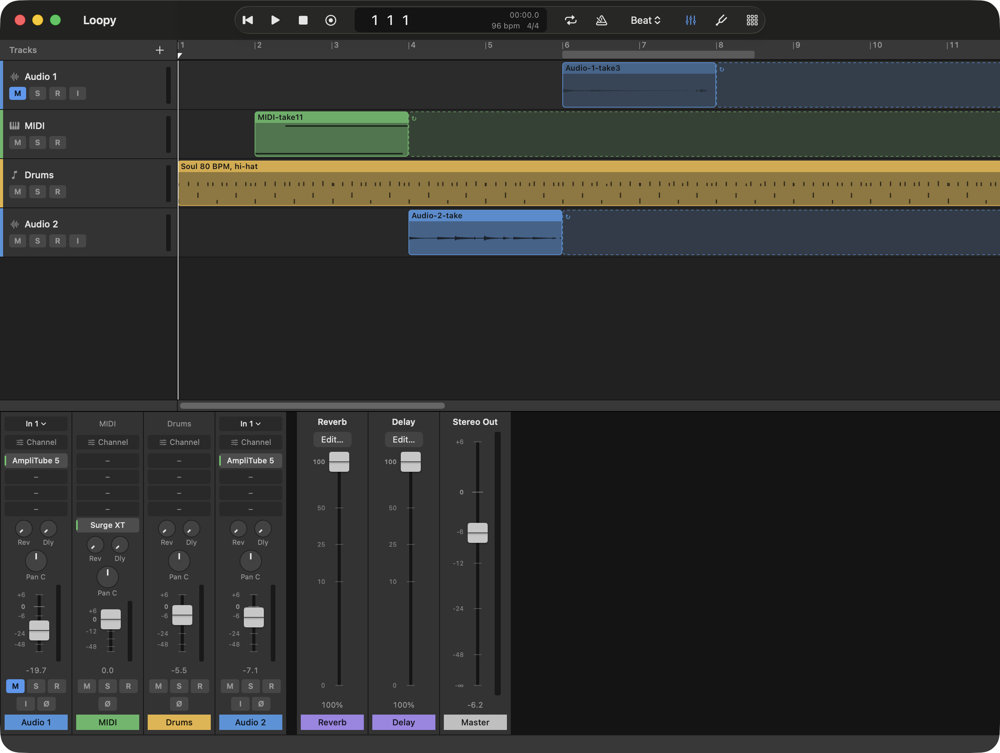
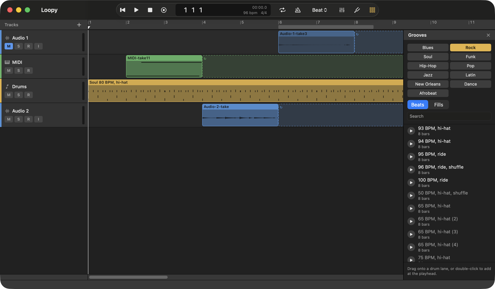

# RoughTrack (SwiftUI)

A simplified multitrack DAW for macOS, with a SwiftUI front end in a flat style. It
ships as RoughTrack.app (bundle id `com.danmullins.roughtrack`), starting at 0.1.1,
and replaces the JUCE RoughTrack on the Mac.

It was forked from the JUCE [RoughTrack](https://github.com/dantaipan/roughtrack) at
826eb8c (0.11.0). The engine was copied, not shared, so the two can drift. The JUCE
project keeps its interface, ready for a possible Windows port.

**[Download RoughTrack for macOS](https://github.com/dantaipan/roughtrack-swift/releases/latest)**:
macOS 14 or later on Apple Silicon, signed and notarized.



## A look around

The mixer docks under the tracks (X). Each track has its input, plugin inserts, reverb
and delay sends, pan and fader, beside the reverb and delay returns and Stereo Out.



The groove browser (G) holds real drummers' grooves by style. Hear one through the drum
track, then drag it onto a lane or double-click to add it at the playhead.



The strobe tuner (⌘U) runs across the top of the window and reads the armed track's input.


Each track's Channel button opens its amp capture, cabinet IR, EQ, compressor and sends.


## Layout

- `engine/`: the audio engine, sessions and plugin hosting (C++, JUCE), as copied
- `core/`: the app's logic without any UI (`Studio`), and `core/bridge/RoughTrackCore.h`,
  the plain-C++ API that Swift imports
- `app/`: the SwiftUI app; `app/project.yml` generates the Xcode project
- `tests/`: Catch2 tests for the engine and the core (`roughtrack_tests`)
- `tools/`: `roughtrack_bench`, which some tests use, and `make_release.sh`

## Building

You need Xcode, CMake, Ninja and XcodeGen (`brew install cmake ninja xcodegen`).

```sh
cmake --preset release && cmake --build --preset release   # engine, core, tests
build/release/tests/roughtrack_tests

cd app && xcodegen generate && open RoughTrackSwift.xcodeproj
```

The Xcode build runs the CMake build first, so after the first configure you can
just build in Xcode. The `.xcodeproj` is generated; edit `app/project.yml`, not the project.

Sessions live in `~/Music/RoughTrack`, and settings and the plugin list in
`~/Library/Application Support/RoughTrack.*`, the same places the JUCE RoughTrack uses,
so it opens the same sessions and keeps the same audio device, latency and plugins.

## Screenshots

The pictures in `docs/screenshots` are the real window, taken by the app itself:

```sh
app=build/xcode/Build/Products/Debug/RoughTrack.app
open -n -W "$app" --args --snapshot=Loopy --output="$PWD/docs/screenshots/mixer.png" --2x --mixer
```

`--snapshot` names a session in `~/Music/RoughTrack` and `--output` the PNG to write.
Add `--mixer`, `--tuner` or `--grooves` to show those, `--channel=<track>` to take that
track's channel window instead (tracks count from 1), and `--2x` for Retina resolution.
It waits for the session's plugins, saves the picture, then reopens the session you had
and puts the window back where it was, and quits. Every argument starts with `--`,
because macOS treats a bare one as a file to open. Quit RoughTrack first, launch it with
`open` as above so macOS asks about RoughTrack itself, and allow it under **System
Settings → Privacy & Security → Screen & System Audio Recording** the first time.

## Releasing

`tools/make_release.sh` archives a Release build signed with Developer ID, notarizes
and staples it, and makes `dist/RoughTrack-<version>.dmg`, also signed, notarized and
stapled. It needs the `roughtrack-notary` notarytool profile. The version is
`MARKETING_VERSION` in `app/project.yml` (and the CMake project version, which the
About box and update checker use).

Releases are published on github.com/dantaipan/roughtrack-swift, where the update
checker (`updates::latestReleaseUrl` in `core/include/roughtrack/Updates.h`) looks for
them. Attach the DMG to each release so the checker can offer a direct download.

## Licence

GNU AGPL 3.0 or later (see LICENSE). JUCE is used under the AGPL.
