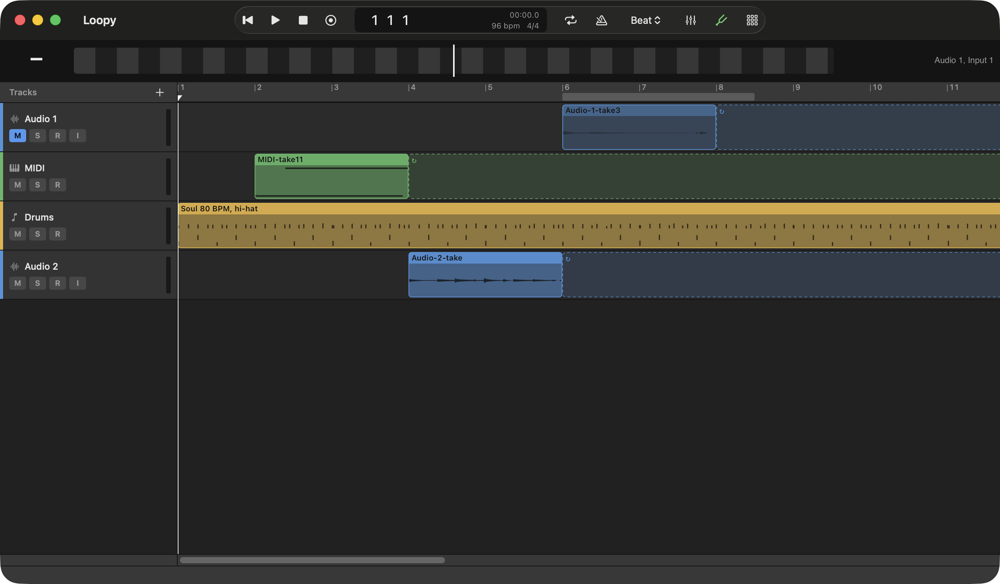
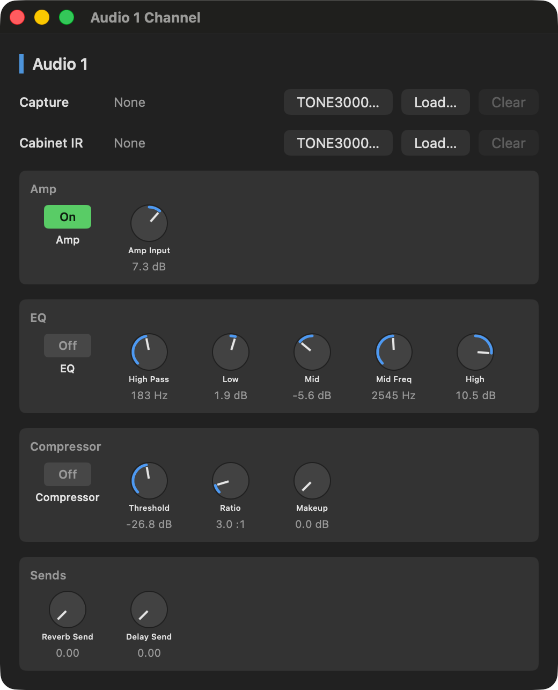

# RoughTrack (SwiftUI)

A simplified multitrack DAW for macOS, with a SwiftUI front end in a flat style. It
ships as RoughTrack.app (bundle id `com.danmullins.roughtrack`), starting at 0.1.1,
and replaces the JUCE RoughTrack on the Mac.

It was forked from the JUCE [RoughTrack](https://github.com/dantaipan/roughtrack) at
826eb8c (0.11.0). The engine was copied, not shared, so the two can drift. The JUCE
project keeps its interface, ready for a possible Windows port.

**[Download RoughTrack for macOS](https://github.com/dantaipan/roughtrack-swift/releases/latest)**:
macOS 14 or later on Apple Silicon, signed and notarized.


## A look around

The mixer docks under the tracks (X). Each track has its input, plugin inserts, reverb
and delay sends, pan and fader, beside the reverb and delay returns and Stereo Out.


The groove browser (G) holds real drummers' grooves by style. Hear one through the drum
track, then drag it onto a lane or double-click to add it at the playhead.


The strobe tuner (⌘U) runs across the top of the window and reads the armed track's input.



Each track's Channel button opens its amp capture, cabinet IR, EQ, compressor and sends.



## TONE3000

**Powered by [TONE3000](https://www.tone3000.com).** The *TONE3000…* button beside a
track's Capture and Cabinet IR opens TONE3000's library of NAM captures and IRs of real
gear, made by a community of musicians:

- **Sign in** once: RoughTrack shows a code to confirm at tone3000.com. The sign-in is
  kept in `~/Library/Application Support/TONE3000 Shared`, a folder named for neither
  app, which RoughStomp (0.6.1 and later) shares: sign in once for both. Signing out, in
  the browser or in Settings, signs out both.
- **Your lists:** Favorites, Created, Downloaded, Trending and Latest, showing only what
  the slot loads (captures or IRs; for a cabinet, TONE3000 is asked for cabs). Choose a
  tone to see its models and load one. **Browse TONE3000** opens TONE3000's own picker in your web
  browser, for searching the whole catalog, and the tone you choose comes back.
- A file from TONE3000 shows the T3K mark and the tone's name in the channel window.
  Click it to choose another model from the same tone.
- Downloads are kept in `TONE3000 Shared/Downloads`, so sessions reopen offline. On
  another Mac, or if a file has gone, it's downloaded again once you're signed in.

## Layout

- `engine/`: the audio engine, sessions and plugin hosting (C++, JUCE), as copied
- `core/`: the app's logic without any UI (`Studio`), and `core/bridge/RoughTrackCore.h`,
  the plain-C++ API that Swift imports
- `app/`: the SwiftUI app; `app/project.yml` generates the Xcode project
- `tests/`: Catch2 tests for the engine and the core (`roughtrack_tests`)
- `tools/`: `roughtrack_bench`, which some tests use, and `make_release.sh`
- TONE3000 comes from RoughStomp's `tone3000/` library (`rs::t3k`), fetched at a pinned
  commit in `cmake/Dependencies.cmake` and compiled against this build's JUCE

## Building

You need Xcode, CMake, Ninja and XcodeGen (`brew install cmake ninja xcodegen`).

```sh
cmake --preset release && cmake --build --preset release   # engine, core, tests
build/release/tests/roughtrack_tests

cd app && xcodegen generate && open RoughTrackSwift.xcodeproj
```

TONE3000 needs RoughStomp's publishable key (client ID) in `tone3000_client_id.local`
at the top of the repo, which git ignores, or `-DROUGHTRACK_T3K_CLIENT_ID=...`. Without
it, RoughTrack builds and runs but doesn't offer TONE3000, and `make_release.sh` refuses
to build a release.

The Xcode build runs the CMake build first, so after the first configure you can
just build in Xcode. The `.xcodeproj` is generated; edit `app/project.yml`, not the project.

Sessions live in `~/Music/RoughTrack`, and settings and the plugin list in
`~/Library/Application Support/RoughTrack.*`, the same places the JUCE RoughTrack uses,
so it opens the same sessions and keeps the same audio device, latency and plugins.

## Screenshots

The pictures in `docs/screenshots` are the real window, taken by the app itself:

```sh
app=build/xcode/Build/Products/Debug/RoughTrack.app
open -n -W "$app" --args --snapshot=Loopy --output="$PWD/docs/screenshots/mixer.png" --2x --mixer
```

`--snapshot` names a session in `~/Music/RoughTrack` and `--output` the PNG to write.
Add `--mixer`, `--tuner` or `--grooves` to show those, `--channel=<track>` to take that
track's channel window instead (tracks count from 1), and `--2x` for Retina resolution.
It waits for the session's plugins, saves the picture, then reopens the session you had
and puts the window back where it was, and quits. Every argument starts with `--`,
because macOS treats a bare one as a file to open. Quit RoughTrack first, launch it with
`open` as above so macOS asks about RoughTrack itself, and allow it under **System
Settings → Privacy & Security → Screen & System Audio Recording** the first time.

## Releasing

`tools/make_release.sh` archives a Release build signed with Developer ID, notarizes
and staples it, and makes `dist/RoughTrack-<version>.dmg`, also signed, notarized and
stapled. It needs the `roughtrack-notary` notarytool profile. The version is
`MARKETING_VERSION` in `app/project.yml` (and the CMake project version, which the
About box and update checker use).

Releases are published on github.com/dantaipan/roughtrack-swift, where the update
checker (`updates::latestReleaseUrl` in `core/include/roughtrack/Updates.h`) looks for
them. Attach the DMG to each release so the checker can offer a direct download.

## Licence

GNU AGPL 3.0 or later (see LICENSE). JUCE is used under the AGPL. The TONE3000 and T3K
logos in `app/RoughTrackSwift/Assets.xcassets` are TONE3000's marks, used unaltered as
its integration guidelines ask, and aren't covered by this licence.
